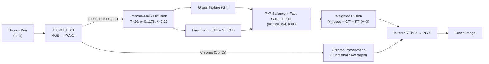
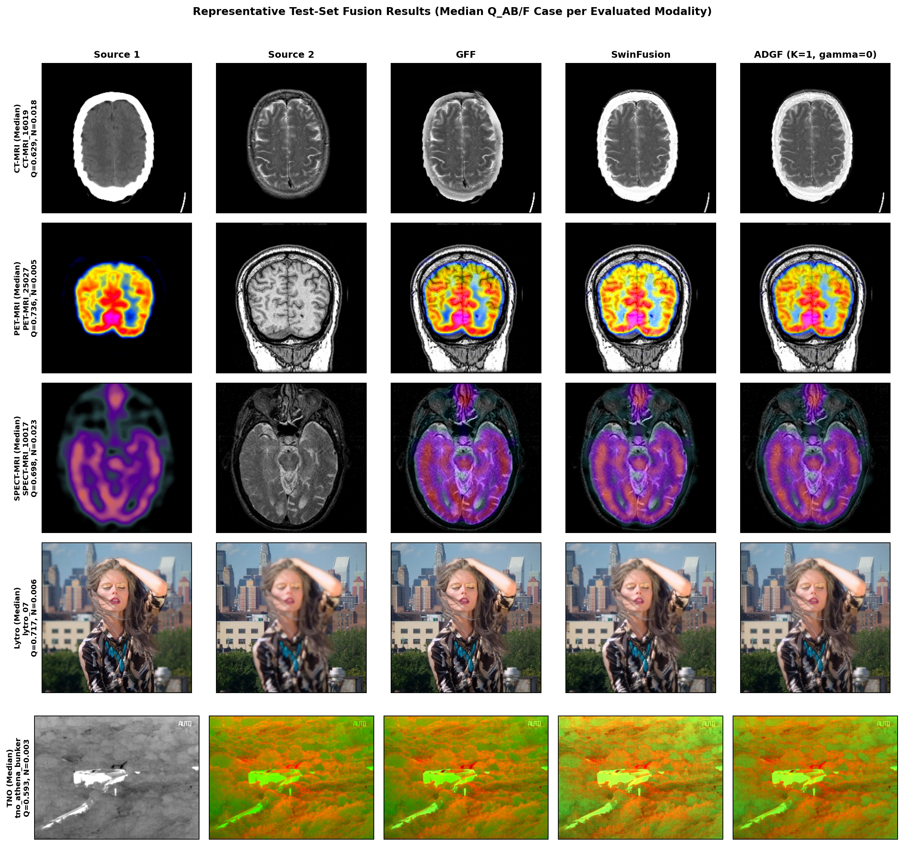
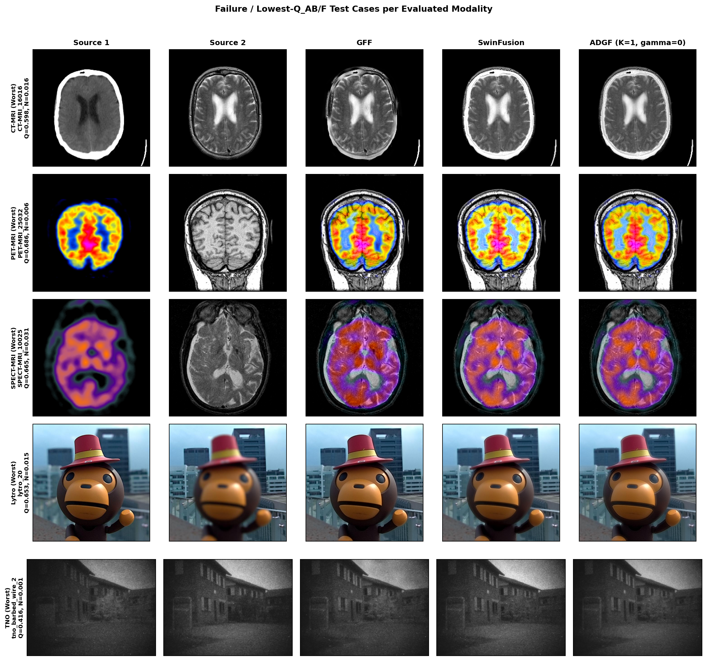

# ADGF / CADM-MSWN — Training-Free Multimodal Image Fusion


A **training-free, deterministic multimodal image fusion** pipeline combining **Perona–Malik Anisotropic Diffusion (PMAD)** and **Guided-Filter Saliency Weighting** (`ADGF`, implemented as `CADM-MSWN` / frozen `CADM_MSWN_v2`), accompanied by a pre-registered, leakage-controlled benchmark across medical, infrared–visible, and multi-focus datasets.

---

## Visual Pipeline



> **Frozen `CADM_MSWN_v2` Configuration (`config.yaml`):** Pre-registered 120-pair development ablation selected **`K = 1`** (unclustered global saliency weighting) and **`γ = 0.0`** (no additive edge compensation), eliminating gradient overshoot artifacts while cutting artifact noise ($N^{AB/F}$) by 90%–98% compared to the early prototype (`K = 3, γ = 0.5`).

---

## Qualitative Results

Representative **median-$Q^{AB/F}$** held-out test results across five evaluated modalities (Source 1, Source 2, GFF, SwinFusion, and frozen ADGF):



<details>
<summary><b>View lowest-Q<sub>AB/F</sub> failure cases across the five modalities</b></summary>



</details>

---

## Benchmark Snapshot (78 Evaluated Test Pairs)

Pooled comparison across **78 held-out test pairs** in [`results/phase4_test_metrics.csv`](results/phase4_test_metrics.csv) (60 complete pairs across Harvard CT-MRI, PET-MRI, SPECT-MRI, and Lytro, plus 18/42 TNO pairs; `*` denotes deep baselines whose published training sets overlap these test distributions):

| Method | Type | $Q^{AB/F}$ ($\uparrow$) | $N^{AB/F}$ ($\downarrow$) | $MI$ [bits] ($\uparrow$) | $SSIM$ ($\uparrow$) | $\text{VIFP}$ ($\uparrow$) | CPU Latency (ms) |
|---|---|---:|---:|---:|---:|---:|---:|
| **Averaging** | Classical | 0.4442 | **0.0001** | 4.1216 | 0.7604 | 0.3452 | **21.5** |
| **DWT** | Classical | 0.5842 | 0.0826 | 3.1531 | 0.7351 | 0.2923 | 56.7 |
| **GFF** | Classical | **0.7394** | 0.0392 | **5.2869** | 0.7340 | **0.5007** | 128.2 |
| **DenseFuse** | Deep AE | 0.4942 | 0.0033 | 3.7378 | **0.7657** | 0.3464 | 762.9 |
| **U2Fusion\*** | Deep CNN | 0.4522 | 0.0323 | 3.4395 | 0.7402 | 0.2953 | 2,494.4 |
| **SwinFusion\*** | Transformer | 0.6675 | 0.0549 | 3.7982 | 0.7585 | 0.3833 | 40,920.4 |
| **ADGF (`K=1, γ=0`)** | **Training-Free** | **0.6758** | **0.0152** | **3.9244** | **0.7557** | **0.3987** | **819.2** |

### Key Takeaways
- **Transparent Negative Results:** Pre-registered development ablations (`120` pairs) showed both additive gradient compensation (`γ > 0`) and discrete feature clustering (`K > 1`) hurt overall rank—leading to the clean frozen `K = 1, γ = 0` formulation.
- **vs. GFF:** GFF remains ahead on edge transfer ($Q^{AB/F}$), $\text{VIFP}$, and overall $MI$, while ADGF wins significantly on **$SSIM$ (76/0/2)** and lower artifact noise **$N^{AB/F}$ (74/0/4)**.
- **vs. Deep Baselines:** Without any training data or GPU, ADGF outperforms **DWT** and **U2Fusion\*** on all 5 primary metrics, outperforms **DenseFuse** on $Q^{AB/F}$, $MI$, and $\text{VIFP}$, and matches or surpasses **SwinFusion\*** on $Q^{AB/F}$ (tie), $N^{AB/F}$, $MI$, and $\text{VIFP}$ (~50× faster on CPU).

---

## Quick Start

### 1. Environment
Tested with Python `3.12.4`, NumPy `1.26.4`, SciPy `1.15.3`, OpenCV `4.10.0`, `scikit-image`, `scikit-learn`, `PyWavelets`, `sewar`, `pandas`, `pyyaml`, and `torch` (for deep baselines).

### 2. Fuse Two Images in Python

```python
import cv2
import yaml
from fusion.fuse import CADMSWNFusion

with open("config.yaml", "r") as f:
    config = yaml.safe_load(f)

img1 = cv2.cvtColor(cv2.imread("path/to/src1.png"), cv2.COLOR_BGR2RGB) / 255.0
img2 = cv2.cvtColor(cv2.imread("path/to/src2.png"), cv2.COLOR_BGR2RGB) / 255.0

pipeline = CADMSWNFusion(config=config)
fused = pipeline.fuse(img1, img2)  # float array in [0, 1]
```

### 3. Run Tests & Benchmarks

```bash
# Run unit tests (26 tests)
pytest -q

# Run sanity comparison across the 5 development sample pairs
python experiments/run_all_baselines_sanity.py

# Run held-out benchmark evaluation
python run_phase4_benchmark.py
```

---

## Repository Structure

```text
Image_Fusion/
├── config.yaml                 # Frozen CADM-MSWN v2 hyperparameters (K=1, gamma=0.0)
├── splits.yaml                 # Pre-registered disjoint dev (120) & test (683) splits
├── fusion/                     # Core ADGF / CADM-MSWN pipeline
│   ├── fuse.py                 # YCbCr/HSV conversion & end-to-end fusion orchestration
│   ├── decomposition.py        # Perona–Malik anisotropic diffusion & GT/GE/FT/FE layers
│   ├── weighting.py            # Local saliency maps, fast guided filter & reconstruction
│   └── clustering.py           # Optional K-Means / FCM pixel regime segmentation
├── baselines/                  # Classical (Averaging, DWT, GFF, ADF, CBF, NSCT) & Deep (DenseFuse, U2Fusion, SwinFusion, CDDFuse, PIAFusion)
├── metrics/                    # Q^AB/F, N^AB/F, MI (bits), SSIM, VIFP, EN, SD, SF, AG & profiler
├── experiments/                # Dev ablations, metric cross-validation & sanity scripts
├── tests/                      # Unit tests for fusion, clustering, color, baselines & metrics
├── results/                    # Benchmark CSVs/JSONs, statistical tests & sanity outputs
└── paper/                      # Full manuscript, LaTeX sources, verified BibTeX & figures
```

---

## Documentation & Audit Trail

- **Full Paper:** [`paper/ADGF_paper_complete.md`](paper/ADGF_paper_complete.md)
- **Pre-Registered Selection Protocol:** [`selection_rule.md`](selection_rule.md)
- **Methodological Limitations & Training Provenance:** [`LIMITATIONS.md`](LIMITATIONS.md)
- **Verification Matrix:** [`CONDITIONS.md`](CONDITIONS.md)
- **Environment & Baseline Blockers:** [`BLOCKERS.md`](BLOCKERS.md)
