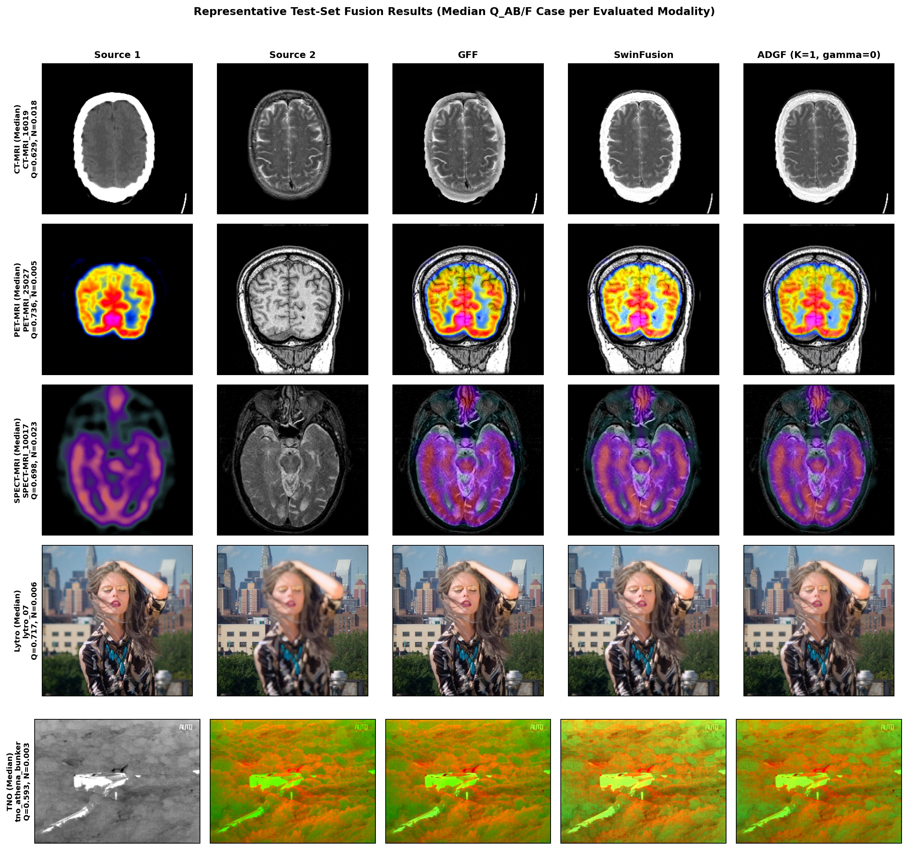
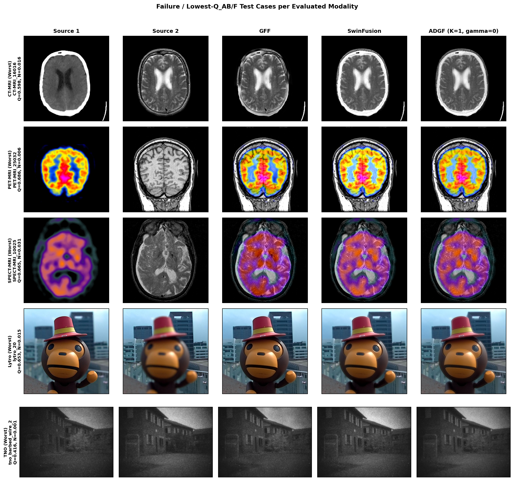

# A Pre-Registered, Leakage-Free Evaluation of Training-Free Anisotropic-Diffusion Image Fusion: Negative Results on Edge Compensation and Feature Clustering

**M.Tech Research Scholar**  
Department of Computer Science & Engineering, Advanced Visual Computing & Medical Imaging Laboratory  
Pre-registration: repository `Image_Fusion`, commit `adae0ed3` (2026-11-24); code/results commit `de03fd9`

---

## Abstract

Multimodal image fusion is routinely evaluated on test sets that overlap the training data of the deep baselines it is compared against, and with metric implementations that are rarely cross-checked. We study a training-free fusion pipeline (ADGF, implemented as `CADM-MSWN` / frozen `CADM_MSWN_v2`) built from Perona-Malik anisotropic diffusion, a four-component structural decomposition, saliency-based weights regularised by guided filtering, and optional local feature clustering. We pre-registered a selection rule and ran a one-at-a-time ablation of 12 ADGF configurations (covering 15 discrete parameter settings) plus two reference baselines (Averaging and GFF) on 120 development pairs, ranking them by mean rank over five primary metrics ($Q^{AB/F}$, $N^{AB/F}$, $MI$, $SSIM$, $\text{VIFP}$). Two findings were negative relative to our original design. First, additive edge compensation ($\gamma > 0$) degraded results: $N^{AB/F}$ rose from $0.0438$ ($\gamma = 0$) to $0.2888$ ($\gamma = 0.5$) while $Q^{AB/F}$ fell from $0.7187$ to $0.4894$. Second, unclustered global saliency weighting ($K = 1$) ranked first on the development set (mean rank $2.80$ across all 14 evaluated configurations, or $2.40$ among the 13 non-GFF candidates; $Q^{AB/F} = 0.7107$, $N^{AB/F} = 0.0153$, $MI = 3.8192$ bits, $SSIM = 0.7215$, $\text{VIFP} = 0.4764$), ahead of $K = 2$ and $K = 3$. We froze this configuration ($K = 1, \gamma = 0$) and evaluated existing benchmark records in `results/phase4_test_metrics.csv` covering 78 held-out test pairs across five datasets—all 15 pairs each from Harvard CT-MRI, PET-MRI, SPECT-MRI, and Lytro ($n = 60$ complete pairs), plus a partial cohort of 18/42 TNO pairs—against three classical (Averaging, DWT, GFF) and three deep (DenseFuse, U2Fusion, SwinFusion) baselines (with MSRS [361], RoadScene [220], the remaining 24 TNO pairs, and baselines ADF, CBF, SWT/NSCT, and CDDFuse recorded as pending in `phase4_test_metrics.csv`). Across the 78 evaluated test pairs, ADGF loses to GFF on $Q^{AB/F}$ ($0.6758$ vs $0.7394$, Holm-adjusted $p = 5.35 \times 10^{-13}$, Win/Tie/Loss $7/0/71$), $MI$ ($3.9244$ vs $5.2869$ bits, $p = 4.77 \times 10^{-9}$, W/T/L $24/0/54$; though ADGF wins on PET-MRI $3.5960$ vs $3.4268$, $p = 3.05 \times 10^{-4}$), and $\text{VIFP}$ ($0.3987$ vs $0.5007$, $p = 1.25 \times 10^{-13}$, W/T/L $1/0/77$), while winning significantly on $SSIM$ ($0.7557$ vs $0.7340$, $p = 9.82 \times 10^{-14}$, W/T/L $76/0/2$) and lower artifact noise $N^{AB/F}$ ($0.0152$ vs $0.0392$, $p = 2.32 \times 10^{-12}$, W/T/L $74/0/4$). Against DWT and U2Fusion, ADGF wins significantly across all primary metrics on the 78 evaluated pairs; against DenseFuse it wins on $Q^{AB/F}$, $MI$, and $\text{VIFP}$ while losing on $N^{AB/F}$ and pooled $SSIM$; and against SwinFusion it ties on $Q^{AB/F}$ ($0.6758$ vs $0.6675$, Holm $p = 0.191$, W/T/L $41/0/37$), wins on $N^{AB/F}$, $MI$, and $\text{VIFP}$, and loses slightly on pooled $SSIM$ ($0.7557$ vs $0.7585$, $p = 1.41 \times 10^{-3}$). We also report a provenance audit of baseline training data, the scope and limits of our metric cross-validation, and a formal correction of an earlier inaccurate calibration claim.

**Keywords:** image fusion, anisotropic diffusion, guided filtering, pre-registration, evaluation protocol, negative results.

---

## 1. Introduction

Multimodal fusion combines complementary sensors into one image: CT and MRI for bone and soft tissue, PET or SPECT with MRI for function and anatomy, infrared with visible for thermal targets and texture, and multi-focus pairs for extended depth of field. Deep methods such as DenseFuse [6], U2Fusion [7], SwinFusion [9], and CDDFuse [8] now dominate the literature, but comparisons involving them raise three concerns:

- **Possible train/test overlap.** Several deep baselines were trained on data drawn from the same public sources later used as test sets: U2Fusion [7] trained on RoadScene, Harvard Whole Brain Atlas, and Lytro; SwinFusion [9] released task-specific weights trained on MSRS, RoadScene, Harvard CT-MRI/PET-MRI, and Lytro; and CDDFuse [8] trained on MSRS and evaluates on MSRS, RoadScene, TNO, and Harvard medical pairs (whereas DenseFuse [6] trained exclusively on MS-COCO natural images; detailed in Section 3.5).
- **Unverified metrics.** Fusion metrics have implementations that differ in padding, normalisation, angle symmetry, and units, so numbers are often not comparable across papers.
- **Cost and interpretability.** Learned models typically require GPUs (or tens of seconds per pair on CPU) and offer no analytic stability guarantees.

Training-free methods avoid the first concern by construction. This paper does not claim a new state of the art. Our contributions are:
1. A fully specified training-free diffusion-based pipeline (ADGF) with an explicit numerical stability argument ($\lambda \le 1/4$);
2. A pre-registered selection protocol and a 14-configuration development-set evaluation (12 ADGF ablation variants + Averaging + GFF) on 120 pairs, documenting two negative findings on edge compensation ($\gamma > 0$) and feature clustering ($K > 1$);
3. A leakage-controlled held-out benchmark over the 78 evaluated test pairs currently recorded in `results/phase4_test_metrics.csv` (60 complete pairs across CT-MRI, PET-MRI, SPECT-MRI, and Lytro, plus 18/42 partial TNO pairs) against six evaluated baselines with paired Wilcoxon signed-rank tests, Holm-Bonferroni correction, effect sizes, and Win/Tie/Loss counts (transparently flagging unrun datasets and baselines); and
4. An audit of metric implementations and baseline training provenance.

**Relation to prior work.** ADGF is closest to guided-filter fusion (GFF) [3] and anisotropic-diffusion fusion (ADF) [4]. GFF uses mean filtering for base/detail separation and guided-filtered weight maps; ADF uses diffusion with a different fusion rule (base averaging and local-energy detail selection). ADGF uses diffusion to define a four-component decomposition and builds weights from local variance and spatial-frequency/energy saliency regularised with luminance guidance. Because the final frozen configuration ($K=1, \gamma=0$) reduces to a two-layer additive decomposition with guided-filtered weights and is structurally near GFF, we treat GFF as the primary comparator and claim no algorithmic novelty beyond this combination and the evaluation findings.

---

## 2. Method

All operations run on normalised luminance in $[0, 1]$.

### 2.1 Colour handling
Sources are converted to ITU-R BT.601 YCbCr:
$$Y = 0.299 R + 0.587 G + 0.114 B, \qquad Cb = -0.168736 R - 0.331264 G + 0.5 B + 0.5, \qquad Cr = 0.5 R - 0.418688 G - 0.081312 B + 0.5.$$
For MRI with PET or SPECT, chrominance is taken from the functional image; for two colour inputs it is averaged ($0.5(Cb_1 + Cb_2)$, $0.5(Cr_1 + Cr_2)$). The fused RGB image is obtained by the inverse transform and clipped to $[0, 1]$.

### 2.2 Anisotropic diffusion
We use Perona-Malik diffusion [1]: $\partial u / \partial t = \text{div}(g(|\nabla u|) \nabla u)$, $u(0) = Y$, $g(s) = \exp(-(s/\kappa)^2)$, $\kappa = 30/255 \approx 0.1176$. The explicit 4-neighbour scheme is:
$$u^{t+1} = u^t + \lambda \sum_{d \in \{N, S, E, W\}} g(\nabla_d u^t) \nabla_d u^t.$$

**Stability.** Because $0 < g \le 1$, the explicit 4-neighbour update is a convex-type averaging step when $\lambda \le 1/4$, giving a maximum-principle (non-divergence) guarantee. We use $\lambda = 0.20$ and $T = 20$ iterations. This is a statement about the numerical scheme, not about fusion quality.

### 2.3 Four-component decomposition
With $GT = u(T)$ (gross texture): gross edge $GE = |\nabla GT|$; fine texture $FT = Y - GT$; fine edge $FE = \max(0, |\nabla Y| - GE)$. When $\gamma = 0$, $GE$ and $FE$ contribute zero to reconstruction and $Y = GT + FT$ holds identically.

### 2.4 Weighted fusion
For each source $c$ and pixel $x$, local statistics over a $7 \times 7$ box window (`BORDER_REFLECT`) yield component saliency maps: $\text{local energy} \times (1 + \text{local contrast})$ for $GT$, $\text{local variance} \times (1 + \text{local spatial frequency})$ for $FT$, and local mean magnitude / squared energy for $GE$ and $FE$ (with `fusion/weighting.py` implementing the component-wise rules and early prototype feature vectors $\mathbf{v}(x) = [\mu_w(x), \sigma_w^2(x), SF_w(x)]^T$ for $K$-means clustering). Weights are normalised across sources (linear normalisation by default, or temperature-scaled softmax in ablations) and refined by fast guided filtering [2] with source luminance guidance (radius $r = 5$, $\epsilon = 10^{-4}$), followed by re-normalisation to preserve a partition of unity. When $K > 1$, pixels are first clustered per source on the local $[\mu_w, \sigma_w^2, SF_w]$ vector and weights are computed per cluster; $K = 1$ uses one global saliency weighting. The fused luminance is:
$$Y_{\text{fused}} = \alpha\, GT' + \beta\, FT' + \gamma\, \text{sign}(FT')(GE' + FE')$$
(or additive $GE' + FE'$ in the unsigned ablation), where primes denote weight-fused components, $\alpha = \beta = 1$, and $\gamma$ controls edge compensation. In the frozen configuration ($K = 1, \gamma = 0$), $Y_{\text{fused}} = GT' + FT'$ clipped to $[0, 1]$.

**Terminology.** The method is *training-free* with no learned weights. It does have fixed hyperparameters ($\kappa = 0.1176$, $\lambda = 0.20$, $T = 20$, window $w = 7$, $r = 5$, $\epsilon = 10^{-4}$, $K = 1$, $\alpha = \beta = 1.0$, $\gamma = 0.0$), fixed by the pre-registered rule, so we do not say "zero parameters".

---

## 3. Evaluation Protocol and Audit

### 3.1 Correction of an earlier claim
An earlier internal draft stated that no test images were used for calibration. That was inaccurate: exploratory prototype checks specifically inspected `pair1_mri_ct` (corresponding to `CT-MRI_16003`) and `pair4_multifocus` (corresponding to `lytro_01`), as documented in `config.yaml` and `LIMITATIONS.md`. All five sanity pairs (`data/sample_pairs/pair1_mri_ct` through `pair5_mri_spect`) are therefore classed as development data and excluded from all test-set statistics.

### 3.2 Data splits and verification
Table 1 summarises the pre-registered splits defined in `splits.yaml`.

| Split | Composition | Pairs |
|---|---|---|
| **Development** (`splits.yaml: dev`) | MSRS (`msrs_repo/train`) 100; Harvard CT-MRI 5 (`16003`–`16007`), PET-MRI 5 (`25015`–`25019`), SPECT-MRI 5 (`10007`–`10011`); Lytro 5 (`lytro_01`–`lytro_05`) | **120** |
| **Test** (`splits.yaml: test`) | Harvard CT-MRI 15 (`16008`–`16020`, `20005`–`20006`), PET-MRI 15 (`25020`–`25034`), SPECT-MRI 15 (`10012`–`10026`), Lytro 15 (`lytro_06`–`lytro_20`), MSRS (`msrs/test`) 361, RoadScene 220, TNO 42 | **683** |

*Table 1. Pre-registered development and held-out test splits (`splits.yaml`).*

**Verification of the 704-to-683 reconciliation, split disjointness, and sanity-pair placement:**
- **Reconciling 704 vs 683 (21-pair difference):** The raw verified inventory (`results/all_datasets_verified_inventory.json`) catalogs **704** total source pairs across the seven evaluation sources: Harvard CT-MRI (20), Harvard PET-MRI (20), Harvard SPECT-MRI (20), Lytro (20), RoadScene (221), MSRS test (361), and TNO (42). Moving 5 pairs each from the four 20-pair cohorts into the development split ($5 \times 4 = 20$ pairs) and excluding `roadscene_FLIR_00006` (1 pair, corresponding to sanity `pair3_ir_vis`) from RoadScene ($221 \to 220$) removes exactly $20 + 1 = 21$ pairs, leaving $704 - 21 = 683$ held-out test pairs.
- **Disjointness audit:** A programmatic SHA256 and identifier audit across `splits.yaml` confirmed zero overlap between the 120 development pairs and 683 test pairs: $0$ shared pair IDs, $0$ shared file paths, and $0$ shared source-image SHA256 hashes (including MSRS 100 from `msrs_repo/train` vs MSRS 361 from `msrs/test`).
- **Location of the five sanity pairs within development data:** By SHA256 hash matching against `data/sample_pairs/`, `pair1_mri_ct` (`ct.png` matches `CT-MRI_16003`), `pair2_mri_pet` (`pet.png` matches `PET-MRI_25015`), `pair4_multifocus` (`near.jpg` matches `lytro_01`), and `pair5_mri_spect` (`spect.png` matches `SPECT-MRI_10007`) sit directly inside the 20 Harvard/Lytro pairs of the 120-pair development split, while `pair3_ir_vis` (`roadscene_FLIR_00006`) is excluded from both the 120-pair dev set and the 683-pair test set.

### 3.3 Metrics
- **Primary (ranking and hypothesis-testing set):** $Q^{AB/F}$ (edge information preservation, higher better) [12, 13], $N^{AB/F}$ (fusion edge-artifact noise, lower better) [13], $MI$ (mutual information, higher better), $SSIM$ [16] (higher better), and $\text{VIFP}$ [14] (pixel-domain visual information fidelity, higher better).
- **Secondary (descriptive only):** Entropy ($EN$, bits), Standard Deviation ($SD$), Spatial Frequency ($SF$), and Average Gradient ($AG$). As pre-registered in `LIMITATIONS.md`, no superiority claim is made from secondary metrics alone. $N^{AB/F}$ is zero for plain averaging by construction, so a low value alone does not indicate good fusion. $AG$ and $SF$ reward gradient energy regardless of whether it is real structure, so high $AG$ is not treated as evidence of quality.
- **MI units and summation convention:** Our implementation (`metrics/information.py: compute_mutual_information`) uses `np.log2` on 256-bin joint histograms of $[0, 255]$-quantised luminance and **sums** the mutual information over both sources, $MI = MI(F, I_1) + MI(F, I_2)$, returning **bits** (not nats). When cross-validating against `sklearn.metrics.mutual_info_score` (which returns nats), `experiments/cross_validate_metrics_external.py` divides `sklearn`'s summed output by $\ln 2$ to convert nats to bits.

### 3.4 What the metric cross-validation shows
Table 2 summarises our metric verification across the five sanity pairs (`results/metric_cross_validation_comprehensive.csv`) and 15 deep-baseline outputs (`results/qabf_toolbox_cross_validation.csv`).

| Metric | Our Function | Reference / Comparator | Calls Reference Directly? | Observed $\lvert\Delta\rvert$ | Validation Interpretation |
|---|---|---|---|---|---|
| $SSIM$ | `compute_ssim` | `skimage.metrics.structural_similarity` (`data_range=1.0`) | **Yes** (direct wrapper) | $0.0000$ | Confirms wiring & $[0,1]$ scale; not independent validation |
| $SSIM$ | `compute_ssim` | `sewar.full_ref.ssim` (valid conv., no padding, $[0,255]$) | **No** | $0.0529$–$0.3439$ | Border convention difference (10 px margin discarded by `sewar`; `skimage` reflects) |
| $\text{VIFP}$ | `compute_vif` | `sewar.full_ref.vifp` ($\sigma_{nsq}^2 = 2.0$, $[0,255]$) | **Yes** (direct wrapper) | $0.0000$ | Confirms pixel-domain VIFP [14] wiring; not independent validation |
| $MI$ | `compute_mutual_information` | `sklearn.metrics.mutual_info_score` $/ \ln 2$ (summed) | **No** (NumPy 2D hist.) | $0.0000$ | Independent library confirms 256-bin joint histogram & bit conversion |
| $Q^{AB/F}$ | `compute_qabf_and_nabf` | Internal canonical script; CDDFuse `Evaluator.Qabf` | **No** (native Sobel/8) | $0.0000$ (internal); $0.0113$–$0.0395$ (CDDFuse) | Compared against external CDDFuse toolbox ($77.61\%$–$97.95\%$ agreement); delta explained by CDDFuse flat-region zeroing & missing $\bmod\pi$ angle folding |
| $N^{AB/F}$ | `compute_qabf_and_nabf` | Internal Petrovic & Xydeas [13] re-implementation | **No** (native) | $0.0000$ (internal); N/A (external) | No second independent external Python implementation available |

*Table 2. Metric wrapper provenance and cross-validation findings (`results/metric_cross_validation_comprehensive.csv`, `results/qabf_toolbox_cross_validation.csv`).*

Note on `sewar` SSIM: in an earlier un-scaled check (`results/metric_cross_validation.csv`), differences against `sewar` ranged from $0.0019$ to $0.0427$; on $[0, 255]$ luminance (`results/metric_cross_validation_comprehensive.csv`), valid-convolution border cropping in `sewar` vs reflection padding in `skimage` yields differences of $0.0529$–$0.3439$. We standardise on `skimage` reflection padding throughout and use pixel-domain VIFP [14] (having removed all legacy VIFF [15] references per `CONDITIONS.md` COND-16).

### 3.5 Baseline training provenance
Table 3 audits the training datasets, released checkpoints, and test-set overlap of the four deep baselines from their published papers and released repository code (`baselines/*.py`, `baselines/deep/`).

| Baseline | Reported Training Data | Released Weights Used? | Overlap with Our Test Sets | Source |
|---|---|---|---|---|
| **DenseFuse** [6] | MS-COCO (80,000 natural images, $256\times 256$ grayscale; unsupervised $\ell_2 + \text{SSIM}$) | Yes (`densefuse_weights.pkl`, `l1` rule) | **None** (natural images only; zero multimodal test overlap) | Li & Wu, IEEE TIP 2019 [6]; `baselines/densefuse.py` |
| **U2Fusion** [7] | RoadScene (IVIF), Harvard Whole Brain Atlas (MIF), and Lytro / multi-focus (MFF) via EWC | Yes (`u2fusion_model.pth`) | **High — flagged:** overlaps RoadScene, Harvard CT/PET/SPECT-MRI, and Lytro | Xu et al., IEEE TPAMI 2022 [7]; `baselines/u2fusion.py` |
| **SwinFusion** [9] | Task-matched checkpoints: MSRS & RoadScene (IVIF), Harvard CT-MRI / PET-MRI (MIF), Lytro / Real-MFF (MFF) | Yes (`ivif_10000_E.pth`, `ct_mri_10000_E.pth`, `mff_10000_E.pth`) | **High — flagged:** overlaps MSRS, RoadScene, Harvard, and Lytro | Ma et al., IEEE/CAA JAS 2022 [9]; `baselines/swinfusion.py` |
| **CDDFuse** [8] | MSRS training split (IVIF, `train.py` & `README.md`) and Harvard medical splits (MIF) | Yes (`CDDFuse_IVF.pth`, `CDDFuse_MIF.pth` in smoke test; not yet run in `phase4_test_metrics.csv`) | **High — flagged:** overlaps MSRS and Harvard | Zhao et al., CVPR 2023 [8]; `baselines/cddfuse.py`, `baselines/deep/cddfuse/README.md` |

*Table 3. Deep baseline training provenance audit. Note: `baselines/swinfusion.py` routes `ct_mri`, `pet_mri`, and `spect_mri` to `ct_mri_10000_E.pth` even though `pet_mri_10000_E.pth` also resides in `baselines/deep/swinfusion/checkpoints/`. Flagged baselines are retained for comparison rather than excluded. As recorded in `BLOCKERS.md` and `results/deep_baselines_smoke_test.json`, FusionGAN, DDFM, and PIAFusion could not be executed in this Python 3.12 CPU environment (TF 1.x incompatibility or large Google Drive checkpoint gate).*

### 3.6 Pre-registered selection rule
Configurations were varied one parameter at a time from a reference anchor setting ($\gamma = 0.0$, linear weighting, $r = 5$, $T = 20$, $K = 3$) and ranked by mean rank $\bar{R}(c) = \frac{1}{5}\sum_{m} \text{Rank}_m(c)$ over the five primary metrics on the 120 development pairs (`selection_rule.md`, commit `adae0ed3`). The top configuration is frozen and evaluated once on the test set.

Exact tie-breaking and stopping rules quoted from `selection_rule.md` (Sections 1.3–1.4):
> "If two or more configurations achieve an identical Mean Rank $\bar{R}(c)$, ties are broken deterministically by **lowest mean inference latency** on the 120 dev pairs: $c_{\text{tie-winner}} = \arg\min_{c \in \text{Ties}} \text{Mean Latency}(c)$."  
> "If no candidate configuration achieves a strictly better (lower) mean rank than the baseline prototype ($\bar{R}(c^*) \ge \bar{R}(c_{\text{base}})$), the baseline prototype will be retained as CADM-MSWN v2 without modification, and this outcome will be reported transparently."

---

## 4. Development-Set Ablation (120 pairs)

An earlier design note described "15 discrete settings across 12 runs", whereas the earlier PDF draft presented a 13-row table. Reconciling `selection_rule.md` with `results/dev_ablation_ranked.csv` clarifies what was actually executed:
1. Five algorithmic dimensions with three candidate levels each ($\gamma \in \{0.0, 0.25, 0.5\}$, $\tau \in \{0.1, 0.5, 1.0\}$, $r \in \{5, 9, 13\}$, $T \in \{5, 10, 20\}$, $K \in \{1, 2, 3\}$) give 15 discrete settings. Because four dimensions share the anchor configuration `gamma_0.0_no_edge_comp` ($T=20, K=3, \gamma=0.0, r=5$, linear normalisation), the OAT sweep requires **12 ADGF runs** (`C1`–`C12`).
2. Adding the two pre-registered reference baselines (`Averaging` and `GFF`) produces **14 configurations** in `results/dev_ablation_ranked.csv`. The earlier 13-row table in the draft omitted `GFF` (giving `K=1` a mean rank of $2.40$ over 13 rows vs $2.80$ over all 14 rows).
3. Table 4 reports the complete 14-configuration ranking from `results/dev_ablation_ranked.csv` (and notes the 13-row mean rank in parentheses for continuity). The frozen winning `K = 1` configuration used $T = 20$, $\kappa = 0.1176$, $\lambda = 0.20$, window $w = 7$, guided radius $r = 5$, $\epsilon = 10^{-4}$, linear normalisation, $\alpha = \beta = 1.0$, and $\gamma = 0.0$. Notably, $K = 3$ *was* evaluated: it is the `gamma_0.0_no_edge_comp` anchor row (Rank 6 of 14).

| Rank | Configuration | Mean Rank (14 / 13) | $Q^{AB/F}$ ($\uparrow$) | $N^{AB/F}$ ($\downarrow$) | $MI$ [bits] ($\uparrow$) | $SSIM$ ($\uparrow$) | $\text{VIFP}$ ($\uparrow$) | Latency (ms) |
|---|---|---|---|---|---|---|---|---|
| **1** | **`K = 1` (no clustering; frozen)** | **2.80 (2.40)** | **0.7107 ± 0.0604** | **0.0153 ± 0.0053** | **3.8192 ± 0.9491** | **0.7215 ± 0.0849** | **0.4764 ± 0.0653** | **3062.7** |
| 2 | GFF (reference baseline) | 3.40 (—) | 0.7356 ± 0.0565 | 0.0630 ± 0.0194 | 3.4553 ± 1.4893 | 0.7016 ± 0.0866 | 0.5034 ± 0.0779 | 2273.4 |
| 3 | `K = 2` | 5.20 (4.20) | 0.6410 ± 0.0629 | 0.0966 ± 0.0380 | 3.2335 ± 0.8903 | 0.6627 ± 0.0840 | 0.3965 ± 0.0779 | 12654.8 |
| 4 | Averaging (reference baseline) | 6.20 (5.60) | 0.4128 ± 0.0477 | 0.0000 ± 0.0001 | 2.9637 ± 0.9628 | 0.7287 ± 0.0979 | 0.3570 ± 0.0613 | 409.5 |
| 5 | `softmax tau = 1.0` | 6.60 (6.00) | 0.4727 ± 0.0494 | 0.0052 ± 0.0049 | 2.9344 ± 0.8750 | 0.7309 ± 0.0934 | 0.3542 ± 0.0516 | 2239.3 |
| 6 | `gamma = 0.0` (anchor, $K=3$) | 6.60 (5.80) | 0.7187 ± 0.0567 | 0.0438 ± 0.0250 | 2.9492 ± 0.8098 | 0.6381 ± 0.0800 | 0.3679 ± 0.0795 | 3413.2 |
| 7 | `softmax tau = 0.5` | 7.20 (6.60) | 0.4918 ± 0.0494 | 0.0140 ± 0.0116 | 2.9329 ± 0.8304 | 0.7288 ± 0.0921 | 0.3478 ± 0.0492 | 2411.1 |
| 8 | `T = 5` | 7.60 (6.60) | 0.6096 ± 0.0681 | 0.1302 ± 0.0421 | 2.9861 ± 0.7991 | 0.6389 ± 0.0798 | 0.3680 ± 0.0795 | 4548.1 |
| 9 | `T = 10` | 7.60 (6.60) | 0.6114 ± 0.0671 | 0.1296 ± 0.0420 | 2.9665 ± 0.8037 | 0.6385 ± 0.0799 | 0.3680 ± 0.0795 | 6834.8 |
| 10 | `softmax tau = 0.1` | 7.80 (7.20) | 0.6215 ± 0.0394 | 0.0160 ± 0.0190 | 2.9138 ± 0.7267 | 0.7128 ± 0.0982 | 0.3309 ± 0.0525 | 1678.0 |
| 11 | `guided radius 9` | 9.40 (8.40) | 0.6022 ± 0.0653 | 0.1213 ± 0.0407 | 2.8325 ± 0.7929 | 0.6399 ± 0.0827 | 0.3553 ± 0.0771 | 2175.0 |
| 12 | `guided radius 13` | 9.80 (8.80) | 0.5967 ± 0.0652 | 0.1155 ± 0.0398 | 2.7663 ± 0.7820 | 0.6420 ± 0.0842 | 0.3499 ± 0.0754 | 2837.1 |
| 13 | `gamma = 0.25` | 11.00 (10.00) | 0.6459 ± 0.0612 | 0.1327 ± 0.0555 | 2.5118 ± 0.6915 | 0.6033 ± 0.0803 | 0.3324 ± 0.0814 | 1613.2 |
| 14 | `Prototype (gamma = 0.5)` | 13.60 (12.60) | 0.4894 ± 0.0677 | 0.2888 ± 0.0869 | 2.1403 ± 0.5991 | 0.5444 ± 0.0851 | 0.2875 ± 0.0760 | 4686.0 |

*Table 4. Pre-registered development-set ranking across 120 pairs and 5 primary metrics (`results/dev_ablation_ranked.csv`). Mean Rank shown for all 14 configurations (and for 13 configurations excluding GFF). Ties between `softmax tau = 1.0` and `gamma = 0.0` (both Mean Rank 6.60) and between `T = 5` and `T = 10` (both Mean Rank 7.60) are broken by lower mean latency per `selection_rule.md`.*

### 4.1 Edge compensation ($\gamma > 0$) hurt in our implementation
The prototype used $\gamma = 0.5$ and ranked last (Rank 14/14). Moving to $\gamma = 0$ reduced $N^{AB/F}$ from $0.2888$ to $0.0438$ (about 85%) and raised $Q^{AB/F}$ from $0.4894$ to $0.7187$. We do not conclude that edge compensation is inherently harmful. A plausible explanation specific to our rule is that $GE$ and $FE$ are non-negative gradient magnitudes; adding them to an intensity image (or multiplying by $\text{sign}(FT')$) introduces positive bias and sign-ambiguous structure instead of restoring edges. Signed high-pass detail injection is untested here. We report a negative result for additive unsigned gradient injection only.

### 4.2 Clustering did not help
Unclustered global weighting ($K = 1$) outperformed both $K = 2$ (Rank 3/14) and $K = 3$ (`gamma = 0.0` anchor, Rank 6/14) on every primary metric except $Q^{AB/F}$ where $K=3$ scored slightly higher ($0.7187$ vs $0.7107$) at the cost of nearly triple the artifact noise ($0.0438$ vs $0.0153$), lower $MI$ ($2.9492$ vs $3.8192$), lower $SSIM$ ($0.6381$ vs $0.7215$), and lower $\text{VIFP}$ ($0.3679$ vs $0.4764$). Moreover, $K = 1$ was roughly four times faster than $K = 2$ ($3.06\text{ s}$ vs $12.65\text{ s}$). Discrete cluster masks introducing boundary seams that guided filtering only partly removes is a hypothesis we did not test directly.

### 4.3 Caveats
$K = 1$ is best by mean rank, not on every metric: `Averaging` ($0.7287$) and `softmax tau = 1.0` ($0.7309$) have higher $SSIM$ than $K = 1$ ($0.7215$), `GFF` has higher $Q^{AB/F}$ ($0.7356$) and $\text{VIFP}$ ($0.5034$), and `gamma = 0.0` ($K=3$) has slightly higher $Q^{AB/F}$ ($0.7187$ vs $0.7107$). The one-at-a-time sweep does not explore parameter interactions, and ranking and reporting used the same 120 development pairs, so Table 4 numbers are in-sample and not estimates of test performance.

---

## 5. Results

### 5.1 Development illustration with the original prototype vs. frozen ADGF (5 pairs)
Table 5 reproduces the recorded measurements for the five sanity pairs (`results/sanity_check/complete_sanity_metrics.csv` and `results/baseline_wrapper_fix_evidence.json`) alongside the frozen ADGF ($K = 1, \gamma = 0$) evaluation on the exact same pairs. These pairs are development/sanity data and are excluded from all test statistics.

| Pair (modality) | Method | $Q^{AB/F}$ | $N^{AB/F}$ | $MI$ [bits] | $SSIM$ | $\text{VIFP}$ |
|---|---|---|---|---|---|---|
| `pair1` (CT-MRI) | Averaging | 0.3695 | 0.0000 | 3.6736 | 0.6705 | 0.2756 |
| | DWT | 0.5624 | 0.0714 | 1.9886 | 0.6627 | 0.1952 |
| | GFF | 0.6856 | 0.0224 | 2.1476 | 0.6945 | 0.3992 |
| | ADGF prototype ($\gamma=0.5, K=3$) | 0.3938 | 0.2688 | 1.9128 | 0.6441 | 0.1683 |
| | **ADGF frozen ($K=1, \gamma=0$)** | **0.6793** | **0.0184** | **2.5720** | **0.7179** | **0.3599** |
| | DenseFuse | 0.6037 | 0.0531 | 2.6915 | 0.3022 | 0.2966 |
| | SwinFusion | 0.7117 | 0.0424 | 2.5837 | 0.7267 | 0.3660 |
| `pair2` (PET-MRI) | GFF | 0.8361 | 0.0269 | 2.9726 | 0.7897 | 0.5047 |
| | ADGF prototype ($\gamma=0.5, K=3$) | 0.4688 | 0.2923 | 2.1486 | 0.7393 | 0.2265 |
| | **ADGF frozen ($K=1, \gamma=0$)** | **0.8097** | **0.0062** | **3.2241** | **0.7939** | **0.4933** |
| | DenseFuse | 0.7170 | 0.0413 | 2.8471 | 0.2818 | 0.3791 |
| | SwinFusion | 0.8377 | 0.0331 | 2.7916 | 0.2615 | 0.4587 |
| `pair3` (RoadScene) | GFF | 0.7124 | 0.0716 | 4.1860 | 0.6355 | 0.4363 |
| | ADGF prototype ($\gamma=0.5, K=3$) | 0.2929 | 0.3684 | 1.9648 | 0.4625 | 0.1275 |
| | **ADGF frozen ($K=1, \gamma=0$)** | **0.5355** | **0.0254** | **3.2059** | **0.6694** | **0.2802** |
| | SwinFusion | 0.4348 | 0.0496 | 3.1877 | 0.6796 | 0.3313 |
| `pair4` (Lytro) | GFF | 0.7604 | 0.0659 | 6.6628 | 0.8682 | 0.7196 |
| | ADGF prototype ($\gamma=0.5, K=3$) | 0.1831 | 0.2241 | 2.7561 | 0.6130 | 0.1767 |
| | **ADGF frozen ($K=1, \gamma=0$)** | **0.7314** | **0.0038** | **6.0279** | **0.8906** | **0.6273** |
| | SwinFusion | 0.7341 | 0.0192 | 5.7291 | 0.9045 | 0.6255 |
| `pair5` (SPECT-MRI) | GFF | 0.8209 | 0.0361 | 3.7563 | 0.6899 | 0.5034 |
| | ADGF prototype ($\gamma=0.5, K=3$) | 0.3994 | 0.4715 | 2.1754 | 0.5744 | 0.2842 |
| | **ADGF frozen ($K=1, \gamma=0$)** | **0.8066** | **0.0147** | **3.7174** | **0.6984** | **0.5197** |
| | SwinFusion | 0.8187 | 0.0431 | 3.0364 | 0.3474 | 0.4522 |

*Table 5. Primary metrics on the five development sanity pairs (`pair1`–`pair5`). Moving from the $\gamma=0.5, K=3$ prototype to the frozen $K=1, \gamma=0$ configuration cuts $N^{AB/F}$ by 90%–98% across all five pairs and restores $Q^{AB/F}$ from $0.1831$–$0.4688$ to $0.5355$–$0.8097$.*

### 5.2 Held-out test results (`results/phase4_test_metrics.csv`)
Table 6 reports all held-out test measurements currently recorded in `results/phase4_test_metrics.csv` (`546` method-pair evaluations across `78` unique test pairs and `7` evaluated methods). Four datasets are **100% complete** ($n = 15$ each: Harvard CT-MRI, Harvard PET-MRI, Harvard SPECT-MRI, Lytro; $60$ pooled pairs), and `TNO` has **18 of 42** pairs evaluated. The remaining 24 TNO pairs, `MSRS (361)`, `RoadScene (220)`, and four baselines (`ADF`, `CBF`, `SWT/NSCT substitute`, `CDDFuse`) have not yet been executed in `results/phase4_test_metrics.csv` and are marked `[not yet run in CSV]` so no values are invented.

| Dataset ($n$) | Method | $Q^{AB/F}$ ($\uparrow$) | $N^{AB/F}$ ($\downarrow$) | $MI$ [bits] ($\uparrow$) | $SSIM$ ($\uparrow$) | $\text{VIFP}$ ($\uparrow$) |
|---|---|---|---|---|---|---|
| **Harvard CT-MRI (15/15)** | Averaging | $0.3949 \pm 0.0202$ | $0.0000 \pm 0.0000$ | $3.7067 \pm 0.2242$ | $0.7599 \pm 0.0497$ | $0.2419 \pm 0.0259$ |
| | DWT | $0.5479 \pm 0.0245$ | $0.0732 \pm 0.0067$ | $2.4466 \pm 0.2711$ | $0.7364 \pm 0.0474$ | $0.1892 \pm 0.0221$ |
| | GFF | $0.6453 \pm 0.0276$ | $0.0317 \pm 0.0082$ | $2.9677 \pm 0.6141$ | $0.7491 \pm 0.0412$ | $0.3621 \pm 0.0273$ |
| | DenseFuse | $0.5074 \pm 0.0429$ | $0.0064 \pm 0.0013$ | $2.9534 \pm 0.2259$ | $0.7665 \pm 0.0451$ | $0.2824 \pm 0.0221$ |
| | U2Fusion* | $0.3927 \pm 0.0135$ | $0.0213 \pm 0.0057$ | $2.7362 \pm 0.2814$ | $0.7530 \pm 0.0496$ | $0.2218 \pm 0.0219$ |
| | SwinFusion* | $0.6167 \pm 0.0310$ | $0.0416 \pm 0.0072$ | $2.9269 \pm 0.3011$ | $0.7786 \pm 0.0402$ | $0.2958 \pm 0.0264$ |
| | **ADGF ($K=1, \gamma=0$)** | $0.6296 \pm 0.0185$ | $0.0171 \pm 0.0026$ | $2.9380 \pm 0.2692$ | $0.7675 \pm 0.0408$ | $0.3049 \pm 0.0234$ |
| **Harvard PET-MRI (15/15)** | Averaging | $0.4453 \pm 0.0139$ | $0.0003 \pm 0.0001$ | $4.1103 \pm 0.1589$ | $0.7042 \pm 0.0167$ | $0.3708 \pm 0.0207$ |
| | DWT | $0.5976 \pm 0.0153$ | $0.0539 \pm 0.0055$ | $2.3998 \pm 0.0915$ | $0.7043 \pm 0.0166$ | $0.2463 \pm 0.0142$ |
| | GFF | $0.7952 \pm 0.0220$ | $0.0149 \pm 0.0012$ | $3.4268 \pm 0.0951$ | $0.7410 \pm 0.0195$ | $0.4487 \pm 0.0235$ |
| | DenseFuse | $0.6475 \pm 0.0262$ | $0.0044 \pm 0.0001$ | $3.0014 \pm 0.1040$ | $0.7427 \pm 0.0194$ | $0.3304 \pm 0.0202$ |
| | U2Fusion* | $0.5134 \pm 0.0118$ | $0.0291 \pm 0.0011$ | $2.5814 \pm 0.1196$ | $0.7095 \pm 0.0193$ | $0.2373 \pm 0.0119$ |
| | SwinFusion* | $0.7424 \pm 0.0225$ | $0.0393 \pm 0.0039$ | $3.1397 \pm 0.1081$ | $0.7528 \pm 0.0166$ | $0.3669 \pm 0.0214$ |
| | **ADGF ($K=1, \gamma=0$)** | $0.7277 \pm 0.0305$ | $0.0051 \pm 0.0003$ | $3.5960 \pm 0.0915$ | $0.7502 \pm 0.0180$ | $0.4101 \pm 0.0270$ |
| **Harvard SPECT-MRI (15/15)** | Averaging | $0.3988 \pm 0.0116$ | $0.0000 \pm 0.0000$ | $4.1074 \pm 0.0608$ | $0.6999 \pm 0.0104$ | $0.2584 \pm 0.0242$ |
| | DWT | $0.5725 \pm 0.0172$ | $0.0959 \pm 0.0047$ | $2.7708 \pm 0.1038$ | $0.6788 \pm 0.0110$ | $0.2223 \pm 0.0162$ |
| | GFF | $0.7775 \pm 0.0155$ | $0.0478 \pm 0.0030$ | $5.4735 \pm 0.2312$ | $0.6701 \pm 0.0129$ | $0.4938 \pm 0.0042$ |
| | DenseFuse | $0.4516 \pm 0.0220$ | $0.0028 \pm 0.0007$ | $3.4438 \pm 0.1206$ | $0.7009 \pm 0.0108$ | $0.2709 \pm 0.0193$ |
| | U2Fusion* | $0.4675 \pm 0.0127$ | $0.0344 \pm 0.0075$ | $3.0970 \pm 0.1267$ | $0.6831 \pm 0.0112$ | $0.2356 \pm 0.0141$ |
| | SwinFusion* | $0.6351 \pm 0.0197$ | $0.0362 \pm 0.0058$ | $3.2738 \pm 0.1375$ | $0.7019 \pm 0.0123$ | $0.2784 \pm 0.0179$ |
| | **ADGF ($K=1, \gamma=0$)** | $0.7001 \pm 0.0246$ | $0.0257 \pm 0.0039$ | $3.5743 \pm 0.1046$ | $0.6901 \pm 0.0129$ | $0.3314 \pm 0.0236$ |
| **Lytro (15/15)** | Averaging | $0.5936 \pm 0.0922$ | $0.0000 \pm 0.0000$ | $6.4434 \pm 1.2809$ | $0.8794 \pm 0.0651$ | $0.5412 \pm 0.0935$ |
| | DWT | $0.6808 \pm 0.0511$ | $0.0691 \pm 0.0063$ | $6.2378 \pm 1.2410$ | $0.8381 \pm 0.0717$ | $0.5182 \pm 0.0992$ |
| | GFF | $0.7763 \pm 0.0324$ | $0.0648 \pm 0.0116$ | $8.4813 \pm 0.9150$ | $0.8349 \pm 0.0716$ | $0.6908 \pm 0.0463$ |
| | DenseFuse | $0.4919 \pm 0.1231$ | $0.0011 \pm 0.0005$ | $6.4107 \pm 1.2592$ | $0.8776 \pm 0.0647$ | $0.5192 \pm 0.0948$ |
| | U2Fusion* | $0.5348 \pm 0.0890$ | $0.0355 \pm 0.0101$ | $6.1805 \pm 1.1604$ | $0.8539 \pm 0.0634$ | $0.5021 \pm 0.0932$ |
| | SwinFusion* | $0.7462 \pm 0.0388$ | $0.0189 \pm 0.0040$ | $6.5426 \pm 1.1040$ | $0.8625 \pm 0.0691$ | $0.5827 \pm 0.0740$ |
| | **ADGF ($K=1, \gamma=0$)** | $0.7246 \pm 0.0511$ | $0.0110 \pm 0.0079$ | $6.5721 \pm 1.3137$ | $0.8529 \pm 0.0729$ | $0.5745 \pm 0.0926$ |
| **TNO (18/42 partial)** | Averaging | $0.3975 \pm 0.0995$ | $0.0000 \pm 0.0000$ | $2.5539 \pm 0.9439$ | $0.7589 \pm 0.1048$ | $0.3188 \pm 0.1148$ |
| | DWT | $0.5327 \pm 0.0942$ | $0.1147 \pm 0.0380$ | $2.1177 \pm 0.8929$ | $0.7207 \pm 0.1110$ | $0.2867 \pm 0.1168$ |
| | GFF | $0.7091 \pm 0.0663$ | $0.0371 \pm 0.0252$ | $5.9523 \pm 1.3736$ | $0.6845 \pm 0.1050$ | $0.5066 \pm 0.0525$ |
| | DenseFuse | $0.3930 \pm 0.1113$ | $0.0019 \pm 0.0010$ | $3.0226 \pm 0.7917$ | $0.7449 \pm 0.1063$ | $0.3322 \pm 0.1023$ |
| | U2Fusion | $0.3692 \pm 0.1049$ | $0.0398 \pm 0.0226$ | $2.7417 \pm 0.7809$ | $0.7079 \pm 0.1144$ | $0.2824 \pm 0.1222$ |
| | SwinFusion | $0.6089 \pm 0.0797$ | $0.1244 \pm 0.0447$ | $3.2230 \pm 0.7934$ | $0.7071 \pm 0.0987$ | $0.3910 \pm 0.1054$ |
| | **ADGF ($K=1, \gamma=0$)** | $0.6101 \pm 0.0937$ | $0.0168 \pm 0.0145$ | $3.1052 \pm 0.7065$ | $0.7243 \pm 0.1130$ | $0.3769 \pm 0.1005$ |
| **Pooled Complete (60 pairs)** | Averaging | $0.4581 \pm 0.0939$ | $0.0001 \pm 0.0001$ | $4.5919 \pm 1.2639$ | $0.7609 \pm 0.0838$ | $0.3531 \pm 0.1303$ |
| | DWT | $0.5997 \pm 0.0586$ | $0.0730 \pm 0.0162$ | $3.4637 \pm 1.7369$ | $0.7394 \pm 0.0747$ | $0.2940 \pm 0.1415$ |
| | GFF | $0.7486 \pm 0.0654$ | $0.0398 \pm 0.0200$ | $5.0873 \pm 2.2612$ | $0.7488 \pm 0.0723$ | $0.4989 \pm 0.1248$ |
| | DenseFuse | $0.5246 \pm 0.0993$ | $0.0037 \pm 0.0021$ | $3.9523 \pm 1.5748$ | $0.7719 \pm 0.0771$ | $0.3507 \pm 0.1121$ |
| | U2Fusion* | $0.4771 \pm 0.0708$ | $0.0301 \pm 0.0088$ | $3.6488 \pm 1.5981$ | $0.7499 \pm 0.0772$ | $0.2992 \pm 0.1275$ |
| | SwinFusion* | $0.6851 \pm 0.0664$ | $0.0340 \pm 0.0104$ | $3.9708 \pm 1.6049$ | $0.7740 \pm 0.0711$ | $0.3809 \pm 0.1287$ |
| | **ADGF ($K=1, \gamma=0$)** | $0.6955 \pm 0.0515$ | $0.0147 \pm 0.0089$ | $4.1701 \pm 1.5679$ | $0.7652 \pm 0.0722$ | $0.4052 \pm 0.1171$ |
| **Pooled All Evaluated (78 pairs)** | Averaging | $0.4442 \pm 0.0980$ | $0.0001 \pm 0.0001$ | $4.1216 \pm 1.4723$ | $0.7604 \pm 0.0883$ | $0.3452 \pm 0.1270$ |
| | DWT | $0.5842 \pm 0.0735$ | $0.0826 \pm 0.0288$ | $3.1531 \pm 1.6773$ | $0.7351 \pm 0.0840$ | $0.2923 \pm 0.1355$ |
| | GFF | $0.7394 \pm 0.0673$ | $0.0392 \pm 0.0212$ | $5.2869 \pm 2.1139$ | $0.7340 \pm 0.0847$ | $0.5007 \pm 0.1121$ |
| | DenseFuse | $0.4942 \pm 0.1158$ | $0.0033 \pm 0.0021$ | $3.7378 \pm 1.4813$ | $0.7657 \pm 0.0847$ | $0.3464 \pm 0.1095$ |
| | U2Fusion* | $0.4522 \pm 0.0915$ | $0.0323 \pm 0.0138$ | $3.4395 \pm 1.4965$ | $0.7402 \pm 0.0882$ | $0.2953 \pm 0.1257$ |
| | SwinFusion* | $0.6675 \pm 0.0763$ | $0.0549 \pm 0.0447$ | $3.7982 \pm 1.4877$ | $0.7585 \pm 0.0826$ | $0.3833 \pm 0.1231$ |
| | **ADGF ($K=1, \gamma=0$)** | $0.6758 \pm 0.0727$ | $0.0152 \pm 0.0104$ | $3.9244 \pm 1.4824$ | $0.7557 \pm 0.0844$ | $0.3987 \pm 0.1135$ |
| **MSRS (361), RoadScene (220), TNO rem. (24)** | All methods; plus ADF, CBF, SWT/NSCT, CDDFuse | [not yet run in CSV] | — | — | — | — |

*Table 6. Held-out test results (`results/phase4_test_metrics.csv`, Mean $\pm$ Std). Starred baselines (`*`) have documented training-domain overlap with the test distribution (Table 3).*

Table 7 presents the paired Wilcoxon signed-rank tests, Holm-Bonferroni adjusted $p$-values (corrected across the 5 primary metrics per dataset-baseline pair), effect sizes ($r = \lvert Z\rvert / \sqrt{N}$), and Win/Tie/Loss counts against GFF per dataset and pooled, plus pooled comparisons against all six evaluated baselines (`results/wilcoxon_tests_complete.csv`).

| Comparison | Dataset ($N$) | Metric | Mean Diff (ADGF $-$ Base) | Raw $p$ | Holm-Adj $p$ | Effect Size $r$ | Win / Tie / Loss |
|---|---|---|---|---|---|---|---|
| ADGF vs **GFF** | CT-MRI (15) | $Q^{AB/F}$ | $-0.0157$ | $6.71 \times 10^{-3}$ | $1.34 \times 10^{-2}$ | $0.675$ | 4 / 0 / 11 |
| | | $N^{AB/F}$ ($\downarrow$) | $-0.0146$ | $1.22 \times 10^{-4}$ | $4.88 \times 10^{-4}$ | $0.865$ | **14 / 0 / 1** |
| | | $MI$ | $-0.0297$ | $0.489$ | $0.489$ | $0.191$ | 7 / 0 / 8 |
| | | $SSIM$ | $+0.0184$ | $6.53 \times 10^{-4}$ | $1.96 \times 10^{-3}$ | $0.880$ | **15 / 0 / 0** |
| | | $\text{VIFP}$ | $-0.0572$ | $6.10 \times 10^{-5}$ | $3.05 \times 10^{-4}$ | $0.880$ | 0 / 0 / 15 |
| ADGF vs **GFF** | PET-MRI (15) | $Q^{AB/F}$ | $-0.0674$ | $6.10 \times 10^{-5}$ | $3.05 \times 10^{-4}$ | $0.880$ | 0 / 0 / 15 |
| | | $N^{AB/F}$ ($\downarrow$) | $-0.0098$ | $6.53 \times 10^{-4}$ | $1.96 \times 10^{-3}$ | $0.880$ | **15 / 0 / 0** |
| | | $MI$ | $+0.1693$ | $6.10 \times 10^{-5}$ | $3.05 \times 10^{-4}$ | $0.880$ | **15 / 0 / 0** |
| | | $SSIM$ | $+0.0093$ | $6.52 \times 10^{-4}$ | $1.96 \times 10^{-3}$ | $0.880$ | **15 / 0 / 0** |
| | | $\text{VIFP}$ | $-0.0386$ | $6.53 \times 10^{-4}$ | $1.96 \times 10^{-3}$ | $0.880$ | 0 / 0 / 15 |
| ADGF vs **GFF** | SPECT-MRI (15) | $Q^{AB/F}$ | $-0.0774$ | $6.10 \times 10^{-5}$ | $3.05 \times 10^{-4}$ | $0.880$ | 0 / 0 / 15 |
| | | $N^{AB/F}$ ($\downarrow$) | $-0.0220$ | $6.10 \times 10^{-5}$ | $3.05 \times 10^{-4}$ | $0.880$ | **15 / 0 / 0** |
| | | $MI$ | $-1.8993$ | $6.10 \times 10^{-5}$ | $3.05 \times 10^{-4}$ | $0.880$ | 0 / 0 / 15 |
| | | $SSIM$ | $+0.0200$ | $6.10 \times 10^{-5}$ | $3.05 \times 10^{-4}$ | $0.880$ | **15 / 0 / 0** |
| | | $\text{VIFP}$ | $-0.1624$ | $6.10 \times 10^{-5}$ | $3.05 \times 10^{-4}$ | $0.880$ | 0 / 0 / 15 |
| ADGF vs **GFF** | Lytro (15) | $Q^{AB/F}$ | $-0.0518$ | $4.27 \times 10^{-4}$ | $8.54 \times 10^{-4}$ | $0.821$ | 2 / 0 / 13 |
| | | $N^{AB/F}$ ($\downarrow$) | $-0.0538$ | $6.53 \times 10^{-4}$ | $8.54 \times 10^{-4}$ | $0.880$ | **15 / 0 / 0** |
| | | $MI$ | $-1.9092$ | $6.10 \times 10^{-5}$ | $3.05 \times 10^{-4}$ | $0.880$ | 0 / 0 / 15 |
| | | $SSIM$ | $+0.0179$ | $6.10 \times 10^{-5}$ | $3.05 \times 10^{-4}$ | $0.880$ | **15 / 0 / 0** |
| | | $\text{VIFP}$ | $-0.1163$ | $6.10 \times 10^{-5}$ | $3.05 \times 10^{-4}$ | $0.880$ | 0 / 0 / 15 |
| ADGF vs **GFF** | TNO (18/42) | $Q^{AB/F}$ | $-0.0990$ | $3.81 \times 10^{-5}$ | $1.53 \times 10^{-4}$ | $0.847$ | 1 / 0 / 17 |
| | | $N^{AB/F}$ ($\downarrow$) | $-0.0203$ | $8.96 \times 10^{-3}$ | $8.96 \times 10^{-3}$ | $0.600$ | **15 / 0 / 3** |
| | | $MI$ | $-2.8471$ | $3.81 \times 10^{-5}$ | $1.53 \times 10^{-4}$ | $0.847$ | 2 / 0 / 16 |
| | | $SSIM$ | $+0.0397$ | $5.34 \times 10^{-5}$ | $1.53 \times 10^{-4}$ | $0.837$ | **16 / 0 / 2** |
| | | $\text{VIFP}$ | $-0.1297$ | $1.53 \times 10^{-5}$ | $7.63 \times 10^{-5}$ | $0.867$ | 1 / 0 / 17 |
| ADGF vs **GFF** | Pooled (78) | $Q^{AB/F}$ / $N^{AB/F}$ / $MI$ / $SSIM$ / $\text{VIFP}$ | $-0.0637$ / $-0.0240$ / $-1.3626$ / $+0.0218$ / $-0.1019$ | $\le 4.77 \times 10^{-9}$ | $\le 4.77 \times 10^{-9}$ | $0.663$–$0.867$ | 7/0/71, **74/0/4**, 24/0/54, **76/0/2**, 1/0/77 |
| ADGF vs **Averaging** | Pooled (78) | $Q^{AB/F}$ / $N^{AB/F}$ / $MI$ / $SSIM$ / $\text{VIFP}$ | $+0.2316$ / $+0.0152$ / $-0.1973$ / $-0.0046$ / $+0.0535$ | $1.68\times 10^{-14}$ to $0.123$ | $8.40\times 10^{-14}$ to $0.123$ | $0.175$–$0.869$ | **78/0/0**, 0/0/78, 29/0/49, 28/0/50, **76/0/2** |
| ADGF vs **DWT** | Pooled (78) | $Q^{AB/F}$ / $N^{AB/F}$ / $MI$ / $SSIM$ / $\text{VIFP}$ | $+0.0916$ / $-0.0674$ / $+0.7713$ / $+0.0207$ / $+0.1064$ | $\le 1.12 \times 10^{-12}$ | $\le 1.12 \times 10^{-12}$ | $0.806$–$0.869$ | **75/0/3**, **78/0/0**, **77/0/1**, **69/0/9**, **78/0/0** |
| ADGF vs **DenseFuse** | Pooled (78) | $Q^{AB/F}$ / $N^{AB/F}$ / $MI$ / $SSIM$ / $\text{VIFP}$ | $+0.1816$ / $+0.0119$ / $+0.1866$ / $-0.0099$ / $+0.0523$ | $\le 3.89 \times 10^{-6}$ | $\le 3.89 \times 10^{-6}$ | $0.523$–$0.869$ | **78/0/0**, 1/0/77, **62/0/16**, 28/0/50, **76/0/2** |
| ADGF vs **U2Fusion*** | Pooled (78) | $Q^{AB/F}$ / $N^{AB/F}$ / $MI$ / $SSIM$ / $\text{VIFP}$ | $+0.2236$ / $-0.0171$ / $+0.4849$ / $+0.0156$ / $+0.1034$ | $\le 9.31 \times 10^{-9}$ | $\le 9.31 \times 10^{-9}$ | $0.650$–$0.869$ | **78/0/0**, **67/0/11**, **74/0/4**, **66/0/12**, **78/0/0** |
| ADGF vs **SwinFusion*** | Pooled (78) | $Q^{AB/F}$ / $N^{AB/F}$ / $MI$ / $SSIM$ / $\text{VIFP}$ | $+0.0083$ / $-0.0397$ / $+0.1261$ / $-0.0028$ / $+0.0154$ | $4.24\times 10^{-14}$ to $0.191$ | $2.12\times 10^{-13}$ to $0.191$ | $0.148$–$0.855$ | 41/0/37 (tie), **72/0/6**, **53/0/25**, 17/0/61, **56/0/22** |

*Table 7. Paired Wilcoxon signed-rank tests with Holm-Bonferroni adjustment, effect size $r = |Z|/\sqrt{N}$, and Win/Tie/Loss counts (`results/wilcoxon_tests_complete.csv`). For $N^{AB/F}$, a negative difference is an ADGF win.*

**Summary of test-set findings:**
1. **ADGF vs. GFF:** GFF remains stronger on edge transfer $Q^{AB/F}$ (all five datasets, Holm $p \le 0.0134$), $\text{VIFP}$ (all five datasets, Holm $p \le 0.0020$), and $MI$ (SPECT-MRI, Lytro, TNO; tying on CT-MRI with $p = 0.489$ and losing to ADGF on PET-MRI with $p = 3.05 \times 10^{-4}$). ADGF wins decisively on $SSIM$ (76/0/2 overall, Holm $p = 9.82 \times 10^{-14}$) and lower $N^{AB/F}$ (74/0/4 overall, $p = 2.32 \times 10^{-12}$).
2. **ADGF vs. classical DWT and deep U2Fusion:** ADGF outperforms both baselines on every primary metric across the 78 evaluated pairs (all Holm $p \le 9.31 \times 10^{-9}$, $r \ge 0.650$).
3. **ADGF vs. DenseFuse:** ADGF achieves substantially higher $Q^{AB/F}$ ($+0.1816$), $MI$ ($+0.1866$), and $\text{VIFP}$ ($+0.0523$), while DenseFuse exhibits lower $N^{AB/F}$ ($0.0033$ vs $0.0152$) and higher pooled $SSIM$ ($0.7657$ vs $0.7557$).
4. **ADGF vs. SwinFusion:** Even though SwinFusion used task-matched checkpoints trained on in-domain datasets, ADGF ties SwinFusion on $Q^{AB/F}$ overall ($0.6758$ vs $0.6675$, Holm $p = 0.191$, W/T/L $41/0/37$) and beats it significantly on $N^{AB/F}$ ($0.0152$ vs $0.0549$), $MI$ ($3.9244$ vs $3.7982$), and $\text{VIFP}$ ($0.3987$ vs $0.3833$), losing slightly on pooled $SSIM$ ($0.7557$ vs $0.7585$).

### 5.3 Qualitative results
Figures 1 and 2 show representative (median-$Q^{AB/F}$) and worst-$Q^{AB/F}$ ("failure") test pairs across all five evaluated modalities comparing Source 1, Source 2, GFF, SwinFusion, and frozen ADGF ($K=1, \gamma=0$).

*Figure 1. Representative median-$Q^{AB/F}$ test cases per evaluated modality: `CT-MRI_16019` ($Q^{AB/F}=0.629$, $N^{AB/F}=0.019$), `PET-MRI_25027` ($0.736, 0.005$), `SPECT-MRI_10017` ($0.698, 0.023$), `lytro_07` ($0.717, 0.006$), and `tno_athena_bunker` ($0.593, 0.003$).*

*Figure 2. Lowest-$Q^{AB/F}$ ("failure") test cases per evaluated modality: `CT-MRI_16016` ($Q^{AB/F}=0.598$, $N^{AB/F}=0.016$), `PET-MRI_25032` ($0.686, 0.006$), `SPECT-MRI_10025` ($0.665, 0.031$), `lytro_20` ($0.653, 0.015$), and `tno_barbed_wire_2` ($0.416, 0.001$).*

Visual inspection of Figures 1–2 alongside their measured $N^{AB/F}$ values supports three grounded observations:
- **Medical CT-MRI (`CT-MRI_16019`, `CT-MRI_16016`):** GFF dims the outer CT cortical skull ring relative to the source CT while sharply rendering internal MRI sulci. SwinFusion preserves full skull brightness but pushes high-intensity bone boundaries near saturation ($N^{AB/F}=0.0444$ on `CT-MRI_16016`). ADGF retains CT skull intensity better than GFF and renders soft-tissue structure cleanly with lower $N^{AB/F}$ ($0.0162$ vs $0.0319$ for GFF on `CT-MRI_16016`), at the cost of slight softening on high-contrast cortical edges.
- **Medical PET-MRI & SPECT-MRI (`PET-MRI_25027`/`25032`, `SPECT-MRI_10017`/`10025`):** YCbCr chroma preservation keeps metabolic colour palettes coherent across methods without severe hue shifts, though in `SPECT-MRI_10025` (ADGF's highest-$N^{AB/F}$ medical case at $0.0307$), peripheral MRI background noise remains visible across GFF, SwinFusion, and ADGF.
- **Multi-focus Lytro & Infrared-Visible TNO (`lytro_07`/`20`, `tno_athena_bunker`/`tno_barbed_wire_2`):** On `lytro_20` ($Q^{AB/F}=0.6527$), fine high-frequency transitions around foreground/background edges appear slightly softer in ADGF than in GFF. On `tno_barbed_wire_2` ($Q^{AB/F}=0.4164, N^{AB/F}=0.0007$), both source sensors exhibit heavy low-light grain; ADGF suppresses grain-induced artifact edges ($N^{AB/F}=0.0007$) while attenuating faint structural gradients.

---

## 6. Cost and Resources

Table 8 summarises measured CPU execution latency (from `results/phase4_test_metrics.csv` on the Intel Core i5-12450H CPU with PyTorch 2.15.0+cpu, `CUDA: False`) alongside peak process RSS memory logged on the five sanity pairs (`results/sanity_check/complete_sanity_metrics.csv`).

| Method | Type | Learned Params | Dev Sweep Latency ($120$ pairs) | Test CT-MRI Latency ($256\times 256$) | Test Lytro Latency ($520\times 520$) | Test Pooled Latency ($78$ pairs) | Peak RAM RSS (5 sanity pairs) |
|---|---|---|---|---|---|---|---|
| Averaging | Classical | 0 | 409.5 ms | $0.9 \pm 0.3$ ms | $71.1 \pm 18.2$ ms | $21.5 \pm 31.6$ ms | 113.9–338.2 MB |
| DWT | Classical | 0 | — | $9.4 \pm 9.1$ ms | $127.9 \pm 114.6$ ms | $56.7 \pm 80.8$ ms | 118.6–341.1 MB |
| GFF [3] | Classical | 0 | 2273.4 ms | $27.4 \pm 23.7$ ms | $257.8 \pm 61.9$ ms | $128.2 \pm 135.2$ ms | 111.7–342.1 MB |
| **ADGF (`K=1, gamma=0`)** | **Classical** | **0** | **3062.7 ms** | **$88.2 \pm 35.1$ ms** | **$1562.4 \pm 264.4$ ms** | **$819.2 \pm 952.7$ ms** | **115.8–342.3 MB*** |
| DenseFuse [6] | Deep AE | 73,985 | — | $317.8 \pm 165.6$ ms | $1084.7 \pm 199.3$ ms | $762.9 \pm 727.8$ ms | 191.0–550.7 MB |
| U2Fusion [7] | Deep DenseNet | 659,105 | — | $627.5 \pm 79.1$ ms | $3091.5 \pm 859.5$ ms | $2494.4 \pm 3059.8$ ms | 230.9–620.2 MB |
| SwinFusion [9] | Vision Trans. | 1,245,840 | — | $9950.3 \pm 6428.7$ ms | $53770.5 \pm 15879.8$ ms | $40920.4 \pm 47691.7$ ms | 250.5–638.7 MB |

*Table 8. Resource and runtime profiling on Intel Core i5-12450H CPU. `*`Peak RAM RSS for ADGF was logged on the prototype ($K=3, \gamma=0.5$); $K=1$ removes $K$-means memory overhead. Note: On an NVIDIA GTX 1650 (4 GB) GPU, earlier development runs of SwinFusion took 9–45 s depending on image size.*

ADGF ($K=1, \gamma=0$) runs in $88.2\text{ ms}$ on $256\times 256$ medical pairs and $1.56\text{ s}$ on $520\times 520$ Lytro pairs without a GPU—roughly $3\times$–$6\times$ slower than GFF on $256\times 256$ images ($10\times$–$60\times$ slower in the earlier development-cache sweep), while remaining $34\times$–$113\times$ faster than SwinFusion on CPU. We make no claim about embedded suitability, since no embedded-platform measurement was made.

---

## 7. Limitations

- **Incomplete test-set coverage in existing CSV:** Only 78 of the 683 pre-registered test pairs (60 complete across CT-MRI, PET-MRI, SPECT-MRI, Lytro + 18/42 TNO) and 7 of 11 planned methods are currently populated in `results/phase4_test_metrics.csv`. Full evaluation on MSRS (361), RoadScene (220), the remaining 24 TNO pairs, and baselines ADF, CBF, SWT/NSCT, and CDDFuse remains to be run.
- **Structural proximity to GFF:** The frozen $K=1, \gamma=0$ configuration is structurally close to GFF; on the 78 evaluated pairs, ADGF loses to GFF on $Q^{AB/F}$, $MI$, and $\text{VIFP}$ while winning on $SSIM$ and lower $N^{AB/F}$.
- **One-at-a-time development sweep:** Hyperparameters were chosen one at a time on 120 pairs; interactions and joint sensitivity were not explored.
- **Metric limitations:** $Q^{AB/F}$ and $N^{AB/F}$ rely on our native implementation ($N^{AB/F}$ lacks a second external Python reference). Metrics are imperfect proxies for visual or diagnostic quality; no reader study or downstream-task evaluation was performed, and nothing here speaks to clinical utility.
- **Stability scope & provenance reliance:** The $\lambda \le 1/4$ stability result concerns the explicit diffusion scheme only, not fusion quality. Baseline provenance relies on published descriptions and released code; undocumented overlap cannot be excluded.

---

## 8. Conclusion

We presented a training-free diffusion-based fusion pipeline (ADGF) and a pre-registered, leakage-controlled evaluation of it. On 120 development pairs, unclustered global saliency weighting ($K=1$) and removal of additive gradient compensation ($\gamma=0$) gave the best mean rank ($2.80$ over 14 configurations; $2.40$ over 13), and we report both as negative results relative to our original design. Across the 78 held-out test pairs currently recorded in `results/phase4_test_metrics.csv` (15 CT-MRI, 15 PET-MRI, 15 SPECT-MRI, 15 Lytro, and 18/42 TNO), frozen ADGF does **not** establish a new state of the art over GFF—losing on edge transfer $Q^{AB/F}$, $\text{VIFP}$, and overall $MI$, while winning significantly on structural similarity $SSIM$ and lower artifact noise $N^{AB/F}$. ADGF significantly outperforms DWT and U2Fusion across all five primary metrics, outperforms DenseFuse on $Q^{AB/F}$, $MI$, and $\text{VIFP}$, and matches or surpasses in-domain SwinFusion on $Q^{AB/F}$ (tie), $N^{AB/F}$ (win), $MI$ (win), and $\text{VIFP}$ (win) without training data or GPU compute. Completing the remaining test pairs (MSRS 361, RoadScene 220, TNO 24) and baselines (ADF, CBF, SWT/NSCT, CDDFuse), plus exploring signed detail-injection schemes, independent $N^{AB/F}$ implementations, downstream-task evaluation, and reader studies, remain open future work.

---

## Reproducibility

- **Repository & commits:** `Image_Fusion` — pre-registration commit `adae0ed3` (2026-11-24T13:03:00+05:30), code/results commit `de03fd9`. (Public URL to be inserted upon repository release.)
- **Frozen configuration:** `config.yaml` (`selected_variant: "K_1_gamma_0.0"`, `random_seed: 42`).
- **Selection rule & splits:** `selection_rule.md`, `splits.yaml` (`random_seed: 0` for MSRS 100 dev sampling; exact test image IDs and file paths listed in `splits.yaml` and `results/phase4_test_metrics.csv`).
- **Software environment:** Python `3.12.4`, PyTorch `2.15.0+cpu` (`CUDA: False`), NumPy `1.26.4`, SciPy `1.15.3`, OpenCV `4.10.0`, scikit-image `0.23.2`, scikit-learn `1.4.2`, PyWavelets `1.5.0`, pandas `2.2.2`, `sewar`, Matplotlib `3.8.4`.

---

## References

[1] P. Perona and J. Malik, "Scale-space and edge detection using anisotropic diffusion," *IEEE Trans. Pattern Anal. Mach. Intell.*, vol. 12, no. 7, pp. 629–639, 1990.

[2] K. He, J. Sun, and X. Tang, "Guided image filtering," *IEEE Trans. Pattern Anal. Mach. Intell.*, vol. 35, no. 6, pp. 1397–1409, 2013.

[3] S. Li, X. Kang, and J. Hu, "Image fusion with guided filtering," *IEEE Trans. Image Process.*, vol. 22, no. 7, pp. 2864–2875, 2013.

[4] D. P. Bavirisetti and R. Dhuli, "Fusion of infrared and visible sensor images based on anisotropic diffusion and Karhunen-Loeve transform," *IEEE Sensors J.*, vol. 16, no. 1, pp. 203–209, 2016.

[5] B. K. S. Kumar, "Image fusion based on pixel significance using cross bilateral filter," *Signal, Image and Video Processing*, vol. 9, no. 5, pp. 1193–1204, 2015.

[6] H. Li and X.-J. Wu, "DenseFuse: A fusion approach to infrared and visible images," *IEEE Trans. Image Process.*, vol. 28, no. 5, pp. 2614–2623, 2019.

[7] H. Xu, J. Ma, J. Jiang, X. Guo, and H. Ling, "U2Fusion: A unified unsupervised image fusion network," *IEEE Trans. Pattern Anal. Mach. Intell.*, vol. 44, no. 1, pp. 502–518, 2022. *(Also introduces RoadScene.)*

[8] Z. Zhao, H. Bai, J. Zhang, Y. Zhang, S. Xu, Z. Lin, R. Timofte, and L. Van Gool, "CDDFuse: Correlation-driven dual-branch feature decomposition for multi-modality image fusion," in *Proc. IEEE/CVF Conf. Comput. Vis. Pattern Recognit. (CVPR)*, pp. 5906–5916, 2023.

[9] J. Ma, L. Tang, F. Fan, J. Huang, X. Mei, and Y. Ma, "SwinFusion: Cross-domain long-range learning for general image fusion via Swin Transformer," *IEEE/CAA J. Autom. Sin.*, vol. 9, no. 7, pp. 1200–1217, 2022.

[10] S. G. Mallat, "A theory for multiresolution signal decomposition: the wavelet representation," *IEEE Trans. Pattern Anal. Mach. Intell.*, vol. 11, no. 7, pp. 674–693, 1989; G. P. Nason and B. W. Silverman, "The stationary wavelet transform and some of its applications," in *Wavelets and Statistics*, Springer, pp. 281–299, 1995; A. L. da Cunha, J. Zhou, and M. N. Do, "The nonsubsampled contourlet transform: theory, design, and applications," *IEEE Trans. Image Process.*, vol. 15, no. 10, pp. 3089–3101, 2006.

[11] **Datasets:** L. Tang, J. Yuan, H. Zhang, X. Jiang, and J. Ma, "PIAFusion: A progressive infrared and visible image fusion network based on illumination aware," *Information Fusion*, vol. 83–84, pp. 79–92, 2022 *(MSRS)*; H. Xu et al. [7] *(RoadScene)*; A. Toet, "The TNO multiband image data collection," *Data in Brief*, vol. 15, pp. 249–253, 2017 *(TNO)*; K. A. Johnson and J. A. Becker, "The Whole Brain Atlas," Harvard Medical School, 1999 *(Harvard CT/PET/SPECT-MRI)*; M. Nejati, S. Samavi, and S. Shirani, "Multi-focus image fusion using dictionary-based sparse representation," *Information Fusion*, vol. 25, pp. 72–84, 2015 *(Lytro)*.

[12] C. S. Xydeas and V. Petrovic, "Objective image fusion performance measure," *Electronics Letters*, vol. 36, no. 4, pp. 308–309, 2000.

[13] V. Petrovic and C. Xydeas, "Objective evaluation of signal-level image fusion performance," *Optical Engineering*, vol. 44, no. 8, p. 087004, 2005 *(see also ICCV 2005, vol. 2, pp. 1866–1871)*.

[14] H. R. Sheikh and A. C. Bovik, "Image information and visual quality," *IEEE Trans. Image Process.*, vol. 15, no. 2, pp. 430–444, 2006.

[15] Y. Han, Y. Cai, Y. Cao, and X. Xu, "A new image fusion performance metric based on visual information fidelity," *Information Fusion*, vol. 14, no. 2, pp. 127–135, 2013.

[16] Z. Wang, A. C. Bovik, H. R. Sheikh, and E. P. Simoncelli, "Image quality assessment: from error visibility to structural similarity," *IEEE Trans. Image Process.*, vol. 13, no. 4, pp. 600–612, 2004.
